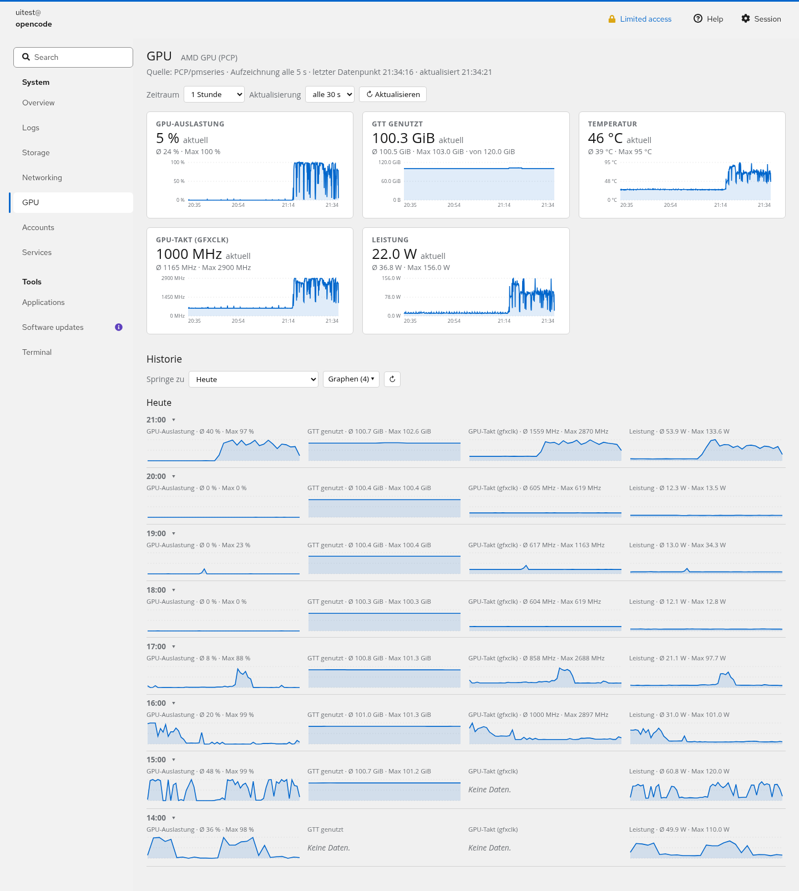

# cockpit-gpu — GPU-Überwachung für Cockpit (AMD Strix Halo)

Eigenes Cockpit-Modul (Menüpunkt **„GPU"**) mit Live-Karten und historischer
Verlaufsansicht für die **AMD Radeon 8060S** eines **Strix-Halo-APU**
(Ryzen AI Max 390, 120 GiB unified memory, Fedora mit Cockpit ≥ 266).

Cockpit selbst hat keinen GPU-Graphen (Upstream-Issue
[cockpit-project/cockpit#13675](https://github.com/cockpit-project/cockpit/issues/13675)),
daher die Kombination aus PCP-Datenerfassung + eigenem Frontend in diesem Repo.



## Architektur

```
 sysfs (/sys/class/drm/card1/device)          sysfs/edac-like PMDA-Werte
        │                                            │
        ▼                                            ▼
 exporter/amdgpu-gtt-mmv  ──MMV──▶  pmdammv     pmdaamdgpu (pcp-pmda-amdgpu)
 (GTT-Belegung, gfxclk; läuft als Dienst)            │
        └───────────────┬────────────────────────────┘
                        ▼
                      pmcd  ◀── Live-Abfrage (pminfo)
                        │
                        ▼
                    pmlogger  ── pmlogconf-Gruppen „gpu/amdgpu" + „gpu/gtt",
                        │        Aufzeichnungsintervall 5 Sekunden
                        ▼
        PCP-Archive (/var/log/pcp/pmlogger/…)
                        │
                        ▼  (Index)
                     valkey  ──▶  pmproxy (REST auf :44322, pmseries-API)
                                      │
                                      ▼
 cockpit-plugin/  (fetch nach http://localhost:44322,
                   Fallback über cockpit.http via Cockpit-Bridge)
```

Das Frontend spricht die **pmseries-REST-API** von pmproxy an
(`/series/query`, `/series/values`). Der direkte pmapi-Endpunkt
`/pmapi/fetch` ist in pmproxy 7.2.2 nicht brauchbar (400) und wird nicht genutzt.

## Metriken

| Anzeige            | Metrik                     | Quelle | Anmerkung |
|--------------------|----------------------------|--------|-----------|
| GPU-Auslastung     | `amdgpu.gpu.load`          | pmdaamdgpu | 0–100 % |
| GTT genutzt        | `mmv.amdgpu.gtt_used`      | MMV-Exporter (sysfs `mem_info_gtt_used`) | Bei Unified-Memory-APUs der *tatsächlich* von der GPU belegte Speicher; Skala gegen `mmv.amdgpu.gtt_total` (~120 GiB) |
| Temperatur         | `amdgpu.gpu.temperature`   | pmdaamdgpu | |
| GPU-Takt (gfxclk)  | `mmv.amdgpu.gfxclk`        | MMV-Exporter (hwmon `freq1_input` = echte sclk, Fallback `pp_dpm_sclk`) | `amdgpu.gpu.clock` des PMDA ist auf dieser APU **konstant 1000 MHz** und damit wertlos |
| Leistung           | `amdgpu.gpu.average_power` | pmdaamdgpu | |

Der Exporter exportiert `amdgpu.*`-Metriknamen zusätzlich unverändert mit
(`gpu/memory.…`), aufgezeichnet werden über die pmlogconf-Gruppen aber nur die
obigen + `gtt_total`/Hilfsgrößen. Der Speicher-Takt (`memclk`) wurde bewusst
entfernt — er steht beim LPDDR5 praktisch immer auf demselben Wert.

## Cockpit-Modul (Frontend)

* **Live-Karten** (oben): aktueller Wert, Ø/Max im gewählten Zeitraum
  (1 h / 6 h / 24 h / 7 d), Auto-Refresh 5–60 s oder Aus, „letzter
  Datenpunkt HH:MM:SS" als sichtbares Feedback; Klick auf eine Karte zeigt den
  Graphen in der Historie.
* **Historie** (unterhalb der Karten) — Nachbau des UX-Musters der
  Cockpit-Metriken-Seite (`/metrics`, Quelltext `pkg/metrics`):
  * **„Springe zu"**: Datumsdropdown „Heute" + 14 vorherige Tage (analog
    `Array(15)`/`today_midnight` im Original).
  * **„Graphen (n) ▾"**: Klick-Dropdown mit Checkboxen, stellt die sichtbaren
    Graphen zusammen (analog *Graph visibility* im Original). Auswahl und
    Datum bleiben per `localStorage` erhalten.
  * Pro **Stunde** ein Block mit den gewählten Graphen **nebeneinander**
    (Minuten-Mittel aus den 5-s-Rohdaten), neueste Stunde zuerst; per ▾
    aufklappbar zu großen Diagrammen mit Achsen (analog
    `metrics-hour`/`metrics-hour-compressed`).
  * Y-Skalierung je Metrik **tagesstabil** (GTT gegen `gtt_total`, sonst
    Tagesmaximum), damit Stunden visuell vergleichbar sind.
  * Leere Tage → „Keine Daten für diesen Tag."
  * Auto-Refresh aktualisiert die laufende Stunde nach (Teilfenster ab
    Stunde−2 h, max. minütlich).
* **CSP-konform**: keine Inline-Styles/Scripts; `manifest.json` erklärt
  `connect-src … http://localhost:44322 http://127.0.0.1:44322`.
* **Datenweg**: primär `fetch` nach `http://localhost:44322` (Mixed-Content-
  Ausnahme für localhost, pmproxy-CORS `*`); Fallback `cockpit.http({address,
  port}).request({path, method})` — funktioniert auch bei Remote-Zugriff auf
  die Cockpit-URL.

## Installation

```bash
sudo ./install.sh
```

Das Skript ist idempotent und richtet alles ein: Pakete (`pcp`,
`pcp-pmda-amdgpu`, `pcp-zeroconf`), PMDA-Registrierung, `valkey` + `pmproxy`,
MMV-Exporter als Dienst `amdgpu-mmv`, pmlogconf-Gruppen, 5-Sekunden-Intervall
in `config.default`, `PMLOGGER_CHECK_SKIP_LOGCONF=yes` und das Cockpit-Plugin
unter `/usr/share/cockpit/gpu`. Danach Cockpit-Seite neu laden.

Deinstallation: `sudo ./uninstall.sh` (löscht keine PCP-Archive).

### Voraussetzungen / Kontext

* Fedora mit `pcp ≥ 6`, Cockpit ≥ 266 (Cockpit 370 getestet)
* AMD-GPU mit amdgpu-Treiber (sysfs `mem_info_gtt_used` vorhanden)
* SELinux: auf dem Zielhost disabled; bei aktivem SELinux sind Kontexte/Booleans
  für pmproxy-Zugriff zu prüfen

## Betrieb & Troubleshooting

Symptome und die in der Praxis verifizierten Ursachen:

| Problem | Ursache / Fix |
|---|---|
| „pmproxy ist nicht erreichbar" im Banner | `pmcd`, `pmlogger`, `pmproxy`, `valkey` prüfen (`systemctl status`) |
| Aufzeichnung trotz Config bei 60 s | `pmlogger_check` (Systemd-Timer) regeneriert `config.default` per `pmlogconf` → `PMLOGGER_CHECK_SKIP_LOGCONF=yes` in `/etc/sysconfig/pmlogger` |
| Intervall-Tag wird ignoriert | pmlogconf akzeptiert **nur kanonisch pluralen** Intervallstring (`5 seconds`, nicht `5 second`); sonst stillschweigend `default` |
| pmseries liefert nichts fürs Zeitfenster | `start`/`finish` nur als **Epoch-Sekunden**; ISO-8601 und Millisekunden funktionieren nicht, `samples` ist für Zeitfenster ungeeignet |
| GPU-Takt bleibt konstant | `amdgpu.gpu.clock` (PMDA) ist auf Strix Halo konstant → `mmv.amdgpu.gfxclk` (hwmon `freq1_input`) verwenden |
| MMV-Metriken fehlen/„invalid" | Enum-Werte: `PM_TYPE_U64=3`, `PM_SEM_INSTANT=2`, `PM_SEM_DISCRETE=3`; Fallback-Verzeichnis `/var/lib/pcp/tmp/mmv` muss existieren (Dienst läuft als User `pcp`) |
| „Keine Daten" im Verlauf kurz nach Start | normal — Historie beginnt erst mit dem ersten pmlogger-Start mit GPU-Gruppen |
| MMV-Metrik trotz Entfernen noch in `pminfo` (Wert 0) | pmdammv merkt sich die Metrik-Tabelle der Datei bis zum pmcd-Neustart; harmlos, nur kosmetisch |

Sichtungs-Befehle:

```bash
pminfo amdgpu mmv.amdgpu                                  # Live-Werte
pmlogsummary -y -S -120seconds <archiv> amdgpu.gpu.load   # Dichte: bei 5 s ≈ 24 Samples
pmseries 'mmv.amdgpu.gfxclk'                              # series-IDs
journalctl -u pmlogger -u amdgpu-mmv -u pmproxy --since -1h
```

## Entwicklung / Tests

```bash
# E2E gegen das laufende Cockpit (Chromium + websockets-Paket nötig):
sudo useradd -m -s /bin/bash uitest && echo 'uitest:<pw>' | sudo chpasswd
E2E_USER=uitest E2E_PW='<pw>' python3 tests/cdp_e2e.py
sudo loginctl terminate-user uitest; sudo userdel -r uitest

# Schnell-Regression ohne Cockpit: statischer Harness mit cockpit.js-Stub,
# z. B. Dateien nach /tmp/uitest/gpu kopieren +
chromium-browser --headless=new --user-data-dir=/tmp/prof \
  --virtual-time-budget=20000 --screenshot=/tmp/shot.png \
  http://localhost:8899/gpu/index.html
```

Der E2E-Test prüft: 5 Karten, Stundenblöcke (neueste zuerst, 5 Zellen),
Stunde aufklappen (SVG 150 px), Sichtbarkeits-Dropdown (5→4 Zellen, Button
„Graphen (4)"), Datumswechsel (Gestern → „Keine Daten", Heute → Blöcke),
Reihenfolge Historie unterhalb der Karten.

Während Entwicklung **nie** `systemctl restart cockpit` — das trennt die
Browser-Session; Plugin-Dateien sind statisch, Browser-Reload genügt.

## Repo-Inhalt

```
cockpit-plugin/   Cockpit-Modul (manifest.json, index.html, gpu.js, gpu.css)
exporter/         amdgpu-gtt-mmv  — PCP-MMV-Exporter (GTT, gfxclk) aus sysfs
                  amdgpu-mmv.service — systemd-Unit (User pcp)
pcp/pmlogconf/gpu/amdgpu  — pmlogconf-Gruppe: PMDA-Metriken
pcp/pmlogconf/gpu/gtt     — pmlogconf-Gruppe: MMV-Metriken
install.sh        Idempotenter Total-Installer (root)
uninstall.sh      Deinstallation (behält PCP-Archive)
tests/cdp_e2e.py  Browser-E2E über Chrome-DevTools-Protocol
docs/screenshot.png
```

## Bekannte Grenzen

* Historie erst ab dem Tag, an dem die GPU-Gruppen in der pmlogger-Config waren.
* pmproxy-`/series/extract` (Downsampling serverseitig) existiert in
  pmproxy 7.2.2 nicht → Minuten-Mittel werden clientseitig gebildet.
* Ein Voll-Tag ≈ 17 300 Rohsamples/Metrik; Teilaktualisierung begrenzt das
  beim Auto-Refresh auf 3 Stunden.
* Die 5-s-Aufzeichnung erhöht die I/O-Last geringfügig; pmlogger-roten
  (`pmlogger_check`) bleiben ohne `SKIP_LOGCONF` aktiv.
